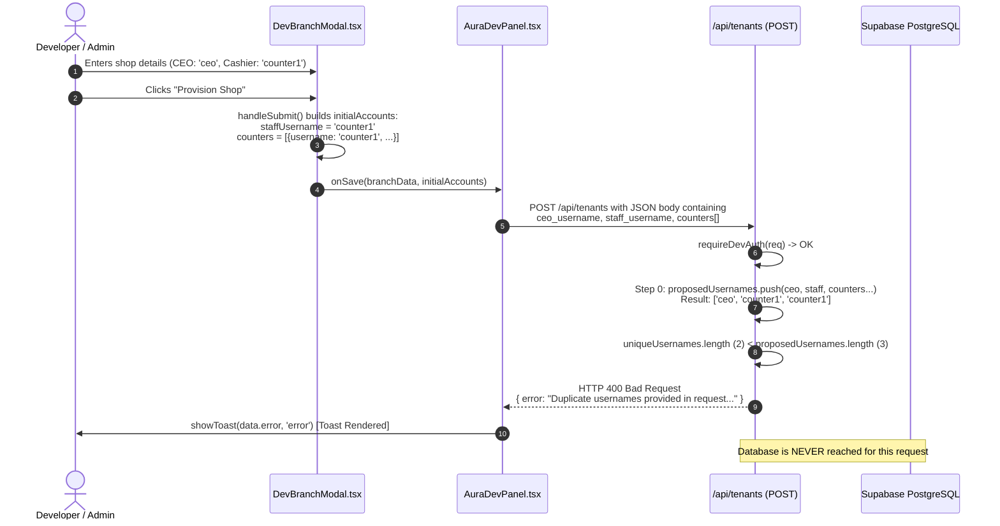

# PyntFlow Forensic Audit: Shop Deletion Followed by Username Reuse Failure

**Audit Date**: October 12, 2026  
**Auditor**: Senior Software Architect, Supabase Database Auditor & Security Reviewer  
**Classification**: Forensic Investigation & Architecture Audit (Read-Only)  
**Target Repository**: `PyntFlow Paint Industry POS & Industrial ERP` (`p-industry`)  
**Target File**: `docs/audits/PYNTFLOW_SHOP_DELETION_USERNAME_AUDIT.md`  
**Related Implementation Plan**: [`docs/plans/PYNTFLOW_TENANT_LIFECYCLE_IMPLEMENTATION_PLAN.md`](file:///d:/bestow/p-industry/docs/plans/PYNTFLOW_TENANT_LIFECYCLE_IMPLEMENTATION_PLAN.md)  
**Related Task Register**: [`docs/tasks/PYNTFLOW_TENANT_LIFECYCLE_TASK_REGISTER.md`](file:///d:/bestow/p-industry/docs/tasks/PYNTFLOW_TENANT_LIFECYCLE_TASK_REGISTER.md)  

---

## 1. Executive Summary

A forensic investigation was conducted to determine why provisioning a new shop fails with the error:
```
Duplicate usernames provided in request. Each user account must have a unique username.
```
after an existing shop was deleted through the Developer Panel (`/dev`).

### Key Findings

1. **Root Cause Confirmed**: The error is **NOT** caused by residual data from the deleted shop, database uniqueness constraints, Supabase Auth conflicts, or stale credentials. The error is generated entirely in-memory at Step 0 of `POST /api/tenants` (`src/app/api/tenants/route.ts#L171-L177`).
2. **Payload Duplication Defect**: The Dev Panel modal ([`DevBranchModal.tsx`](file:///d:/bestow/p-industry/src/components/dev-panel/DevBranchModal.tsx#L147-L153)) constructs a payload containing both a legacy scalar `staffUsername` (initialized to `counters[0].username`, e.g. `'counter1'`) and an array `counters` (which also contains `counters[0]`).
3. **Flawed Pre-Flight Validation Logic**: In `src/app/api/tenants/route.ts#L158-L168`, the pre-flight validator pushes `staff_username` and then iterates `body.counters`, pushing each counter username. Consequently, the first counter username is added twice, creating the array `['ceo', 'counter1', 'counter1']`. Because `Set(['ceo', 'counter1']).size` (2) is less than `proposedUsernames.length` (3), the server immediately rejects the request with HTTP 400 and the literal error string.
4. **False Correlation with Shop Deletion**: The user perceived this as a shop-deletion or username-reuse bug because they attempted the operation after deleting a shop. However, live database verification confirmed that the deleted shop and its user accounts were completely removed from `public.tenants` and `public.app_users`. The provisioning failure occurs on **every** shop creation request that includes cash registers, regardless of whether a deletion preceded it.
5. **Secondary Critical Blocker Discovered**: Even if the pre-flight validation issue is bypassed, shop provisioning will immediately abort and roll back at Step 2 ([`src/app/api/tenants/route.ts#L243`](file:///d:/bestow/p-industry/src/app/api/tenants/route.ts#L243)) because the code attempts an insert into `public.ceo_tenants`, a table that does not exist in the database.

---

## 2. Exact Reproduction Scenario & Reported Error

### 2.1 The Observed Incident
1. An administrator navigated to `pyntflow.com/dev` (Developer Hub).
2. The administrator deleted an existing branch using the delete action on the `Branches & Godowns` view.
3. The deletion completed successfully, leaving `0 Retail Shops`, `0 Central Godowns`, and `0 Paint Factories`.
4. The administrator clicked **"+ Provision Shop / Godown"** and submitted the modal with:
   - **Shop Name**: `hamza`
   - **Shop URL Identifier (Slug)**: `/ hamza`
   - **City / Main Location**: `karachi`
   - **Shop Owner (CEO) Name**: `hamza`
   - **Email Address**: `hamza@gmail.com`
   - **Phone Number**: `03001234567`
   - **Shop / Godown Physical Address**: `Musharraf colony hawksbay road`
   - **CEO Username**: `ceo`
   - **CEO Password**: `***`
   - **POS Cash Registers (1 Active Cashiers)**:
     - Register Name: `Main shop`
     - Login Username: `counter1`
     - Password: `***`
5. Upon clicking **"Provision Shop (1 Branches)"**, a red toast appeared in the upper-right corner:
   ```
   Duplicate usernames provided in request. Each user account must have a unique username.
   ```

---

## 3. Relevant Architecture & Call Paths



### Component Architecture
* **Frontend Form**: [`src/components/dev-panel/DevBranchModal.tsx`](file:///d:/bestow/p-industry/src/components/dev-panel/DevBranchModal.tsx)
* **Dev Panel Coordinator**: [`src/components/dev-panel/AuraDevPanel.tsx`](file:///d:/bestow/p-industry/src/components/dev-panel/AuraDevPanel.tsx)
* **API Handler**: [`src/app/api/tenants/route.ts`](file:///d:/bestow/p-industry/src/app/api/tenants/route.ts)
* **Auth Session Utility**: [`src/lib/session.ts`](file:///d:/bestow/p-industry/src/lib/session.ts)
* **Database Client**: [`src/lib/supabase.ts`](file:///d:/bestow/p-industry/src/lib/supabase.ts)

---

## 4. Exact Error-Generation Trace

The literal error string resides at line 175 of [`src/app/api/tenants/route.ts`](file:///d:/bestow/p-industry/src/app/api/tenants/route.ts#L173-L177):

```typescript
// File: src/app/api/tenants/route.ts (Lines 158-177)

// 0. Pre-Flight Unique Username Validation across all proposed user accounts (DEV-02)
const proposedUsernames: string[] = [];
if (ceo_username?.trim()) proposedUsernames.push(ceo_username.trim().toLowerCase());
if (staff_username?.trim()) proposedUsernames.push(staff_username.trim().toLowerCase());
if (Array.isArray(body.counters)) {
  for (const c of body.counters) {
    if (c?.username?.trim()) {
      proposedUsernames.push(c.username.trim().toLowerCase());
    }
  }
}

// Check for internal duplicates within request
const uniqueUsernames = Array.from(new Set(proposedUsernames));
if (uniqueUsernames.length < proposedUsernames.length) {
  return NextResponse.json({
    success: false,
    error: 'Duplicate usernames provided in request. Each user account must have a unique username.'
  }, { status: 400 });
}
```

### Trace Step-by-Step

1. **State Initialization in Modal**:
   In [`src/components/dev-panel/DevBranchModal.tsx`](file:///d:/bestow/p-industry/src/components/dev-panel/DevBranchModal.tsx#L35-L37):
   ```typescript
   const [counters, setCounters] = useState<Array<{ username: string; password: string; name: string }>>([
     { username: 'counter1', password: '123', name: 'Counter 01 (Main POS)' }
   ]);
   ```
2. **Payload Packaging in Modal**:
   In [`src/components/dev-panel/DevBranchModal.tsx`](file:///d:/bestow/p-industry/src/components/dev-panel/DevBranchModal.tsx#L144-L155):
   ```typescript
   !editingBranch
     ? {
         ceoUsername: ceoUsername.trim(),
         ceoPassword: ceoPassword.trim(),
         staffUsername: counters[0]?.username.trim().toLowerCase() || `${cleanSlug}_counter1`,
         staffPassword: counters[0]?.password.trim() || '123',
         counters: counters.map(c => ({
           username: c.username.trim().toLowerCase(),
           password: c.password.trim(),
           name: c.name.trim(),
         }))
       }
     : undefined
   ```
   Here, `staffUsername` is deliberately assigned `counters[0].username` (`"counter1"`).
3. **HTTP Dispatch in Shell**:
   In [`src/components/dev-panel/AuraDevPanel.tsx`](file:///d:/bestow/p-industry/src/components/dev-panel/AuraDevPanel.tsx#L137-L144):
   ```typescript
   const payload = {
     ...branchData,
     ceo_username: initialAccounts?.ceoUsername,
     ceo_password: initialAccounts?.ceoPassword,
     staff_username: initialAccounts?.staffUsername,
     staff_password: initialAccounts?.staffPassword,
     counters: (initialAccounts as any)?.counters,
   };
   ```
4. **Backend Ingestion in `POST /api/tenants`**:
   The request arrives with:
   - `ceo_username = "ceo"`
   - `staff_username = "counter1"`
   - `counters = [{ username: "counter1", ... }]`
5. **Array Assembly in Route**:
   - `proposedUsernames.push(ceo_username)` &rarr; `['ceo']`
   - `proposedUsernames.push(staff_username)` &rarr; `['ceo', 'counter1']`
   - Loop on `body.counters`: `proposedUsernames.push(c.username)` &rarr; `['ceo', 'counter1', 'counter1']`
6. **Set Comparison**:
   - `proposedUsernames` = `['ceo', 'counter1', 'counter1']` (length = 3)
   - `uniqueUsernames` = `['ceo', 'counter1']` (length = 2)
   - Condition: `2 < 3` &rarr; `true`
7. **Immediate 400 Return**:
   The validation check immediately halts execution, returning the error before any database query is issued.

---

## 5. Shop-Deletion Workflow Audit

### 5.1 Invocation and Operations
Deletion is triggered by `handleDeleteBranch` in [`AuraDevPanel.tsx#L171-L189`](file:///d:/bestow/p-industry/src/components/dev-panel/AuraDevPanel.tsx#L171-L189), calling `DELETE /api/tenants` with `{ id }`.

In [`src/app/api/tenants/route.ts#L359-L476`](file:///d:/bestow/p-industry/src/app/api/tenants/route.ts#L359-L476), the deletion performs sequential cleanup using `supabaseAdmin`:

| Step | Target Table | Filter / Condition | Failure Handling |
| :--- | :--- | :--- | :--- |
| 1 | `branch_order_items`, `branch_orders` | `from_tenant_id = id OR to_tenant_id = id` | Isolated `try/catch` |
| 2 | `invoice_items`, `invoices` | `tenant_id = id` | Isolated `try/catch` |
| 3 | `purchase_items`, `purchases` | `tenant_id = id` | Isolated `try/catch` |
| 4 | `token_transactions` | `tenant_id = id` | Isolated `try/catch` |
| 5 | `tenant_receipt_template` | `tenant_id = id` | Isolated `try/catch` |
| 6 | `branch_order_items`, `branch_orders` | (Duplicate cleanup pass) | Isolated `try/catch` |
| 7 | `app_users` | `tenant_id = id` | Direct execution |
| 8 | `held_invoices` | `tenant_id = id` | Direct execution |
| 9 | `items` | `tenant_id = id` | Direct execution |
| 10 | `shifts` | `tenant_id = id` | Direct execution |
| 11 | `petty_expenses` | `tenant_id = id` | Direct execution |
| 12 | `clients` | `tenant_id = id` | Direct execution |
| 13 | `suppliers` | `tenant_id = id` | Direct execution |
| 14 | `audit_logs` | `tenant_id = id` | Direct execution |
| 15 | `vouchers` | `tenant_id = id` | Direct execution |
| 16 | `tenants` | `id = id` | Throws if error |

### 5.2 Forensic Assessment of Deletion
* **Hard Deletion**: Deletion is a hard purge from PostgreSQL tables. No soft-delete column (`deleted_at`) is used.
* **`app_users` Purge**: Line 458 (`supabaseAdmin.from('app_users').delete().eq('tenant_id', id)`) explicitly purges all users belonging to the tenant.
* **Foreign Key Behavior**: Database foreign key definition for `app_users.tenant_id`:
  ```sql
  FOREIGN KEY (tenant_id) REFERENCES tenants(id) ON DELETE SET NULL
  ```
  While the Postgres constraint specifies `ON DELETE SET NULL`, the API route explicitly removes child rows before deleting the tenant row.
* **No Database Leftovers**: Direct query of the live database (`ignspvajzblmsbertmmv`) confirmed 0 tenant rows and 0 tenant-associated `app_users` rows. Only 1 row exists in `app_users`: the global `admin` (`role = 'developer'`, `tenant_id = null`).

---

## 6. Username Validation Logic Audit

The route implements two distinct validation tiers in Step 0:

```typescript
// Tier 1: In-Request Internal Uniqueness
const uniqueUsernames = Array.from(new Set(proposedUsernames));
if (uniqueUsernames.length < proposedUsernames.length) {
  return NextResponse.json({
    success: false,
    error: 'Duplicate usernames provided in request. Each user account must have a unique username.'
  }, { status: 400 });
}

// Tier 2: Global Database Uniqueness
if (uniqueUsernames.length > 0) {
  const { data: existingUsers, error: checkErr } = await supabaseAdmin
    .from('app_users')
    .select('username')
    .in('username', uniqueUsernames);

  if (checkErr) throw checkErr;

  if (existingUsers && existingUsers.length > 0) {
    const takenList = existingUsers.map(u => u.username).join(', ');
    return NextResponse.json({
      success: false,
      error: `Username(s) already taken globally: ${takenList}. Please choose different usernames.`
    }, { status: 400 });
  }
}
```

### Comparison of Error Messages

| Condition | Responsible Code | Error Message Returned |
| :--- | :--- | :--- |
| Request contains duplicate usernames internally | Lines 171–177 | `Duplicate usernames provided in request. Each user account must have a unique username.` |
| Request username already taken in database | Lines 188–194 | `Username(s) already taken globally: <usernames>. Please choose different usernames.` |

Because the user received the **Tier 1** error, the database was never checked, and no database uniqueness conflict was triggered.

---

## 7. New-Shop Provisioning Lifecycle

```mermaid
flowchart TD
    Start([POST /api/tenants]) --> Auth[requireDevAuth Validation]
    Auth --> Step0A[Pre-Flight Internal Duplicate Check]
    Step0A -- Duplicates Detected --> Err0A[400: Duplicate usernames provided in request]
    Step0A -- Unique --> Step0B[Pre-Flight Global Database Check]
    Step0B -- Usernames Taken --> Err0B[400: Username(s) already taken globally]
    Step0B -- Available --> Step1[1. Insert Tenant into public.tenants]
    Step1 -- Duplicate Slug --> ErrSlug[400: URL slug already exists]
    Step1 -- Succeeded --> Step2[2. Hash CEO Password & Insert CEO into public.app_users]
    Step2 --> Step2Map[Link to public.ceo_tenants]
    Step2Map -- Relation Does Not Exist --> Rollback[Catch Block: Rollback Tenant & Users]
    Rollback --> Err500[500: Failed to provision branch accounts]
    Step2Map -- Succeeded --> Step3[3. Hash Staff Password & Insert staff_username]
    Step3 --> Step4[4. Hash & Insert Additional Counters]
    Step4 --> Step5[5. Seed Catalog Products from Sister Branch]
    Step5 --> Success([200: Tenant & Accounts Provisioned])

    classDef red fill:#ffcccc,stroke:#ff0000,color:#990000;
    class Err0A,Err0B,ErrSlug,Err500,Rollback red;
```

### Provisioning Steps and Execution Status

1. **Step 0 (Pre-Flight)**: Fails here immediately whenever `staff_username` and `counters` are both supplied.
2. **Step 1 (Tenant Insertion)**: Inserts row into `public.tenants`.
3. **Step 2 (CEO User Creation)**: Inserts row into `public.app_users`.
4. **Step 2 Mapping (`ceo_tenants`)**: **CRITICAL DEFECT**. Calls `supabaseAdmin.from('ceo_tenants').insert(...)`. Because `ceo_tenants` was dropped in past migrations/refactors, this call will throw `relation "ceo_tenants" does not exist`, triggering tenant rollback.
5. **Step 3 (`staff_username` Insertion)**: Inserts primary counter.
6. **Step 4 (`counters` Loop)**: Lines 273-287 specifically filter:
   ```typescript
   if (c.username && c.password && c.username.trim().toLowerCase() !== staff_username?.trim().toLowerCase())
   ```
   This proves the author of lines 271-288 knew `body.counters` duplicated `staff_username`, but the author of Step 0 (lines 158-168) failed to apply the same filter.

---

## 8. Database Integrity & Supabase Auth Findings

### 8.1 Supabase Auth vs `app_users`
* **Finding**: PyntFlow does **not** utilize Supabase Auth (`auth.users`) for shop staff, cashiers, or CEOs.
* **Evidence**:
  - Live query `SELECT id, email, created_at FROM auth.users` returned `[]` (0 rows).
  - Search across `src/` revealed 0 calls to `supabase.auth.signUp()`, `supabaseAdmin.auth.admin.createUser()`, or any Supabase Auth identity API.
  - Authentication is 100% custom, utilizing `public.app_users`, bcrypt password hashing ([`src/lib/auth-passwords.ts`](file:///d:/bestow/p-industry/src/lib/auth-passwords.ts)), and jose JWT tokens in cookies ([`src/lib/session.ts`](file:///d:/bestow/p-industry/src/lib/session.ts)).

### 8.2 Database Constraints on `public.app_users`
Verified via PostgreSQL catalog query on live database `ignspvajzblmsbertmmv`:

```
Table: public.app_users
- Primary Key: id (uuid, gen_random_uuid())
- Unique Constraint: app_users_username_key (UNIQUE (username))
- Role Check: app_users_role_check (role IN ('developer', 'ceo', 'staff', 'godown_staff'))
- Foreign Key: app_users_tenant_id_fkey (tenant_id REFERENCES tenants(id) ON DELETE SET NULL)
```

### 8.3 Live Database Table Status
* `public.tenants`: 0 rows.
* `public.app_users`: 1 row (`admin`, `developer`, `tenant_id: null`).
* `public.ceo_tenants`: **Does not exist** (`information_schema.tables` returned `[]`).

---

## 9. Security & Multi-Tenant Findings

### 9.1 Service-Role Client Usage
* All operations in `src/app/api/tenants/route.ts` execute using `supabaseAdmin`, bypassing PostgreSQL Row-Level Security (RLS).
* RLS policies on `tenants` and `app_users` permit access only to `service_role`. Application-level security is enforced via `requireDevAuth(req)` in [`src/lib/session.ts`](file:///d:/bestow/p-industry/src/lib/session.ts#L199-L234).

### 9.2 Non-Transactional Cascade Deletion Risk
* `DELETE /api/tenants` performs 16 distinct database operations across multiple tables.
* It does not run inside a single PostgreSQL transaction (`BEGIN ... COMMIT`).
* If an unexpected database failure occurs midway through deletion (e.g. at step 9), preceding deletions remain committed while the tenant record and subsequent child records survive, resulting in partial state.

### 9.3 Inconsistent Cascade Configuration
* `app_users.tenant_id` is configured with `ON DELETE SET NULL` at the database schema level.
* If a tenant is deleted via raw SQL or external tool rather than through `/api/tenants`, its user accounts will become orphaned with `tenant_id = null` rather than being deleted, which would block future reuse of those usernames due to `app_users_username_key`.

---

## 10. Existing Test Coverage & Gaps

Static review of all files in `scripts/`, `src/`, and root directories was conducted:

| Test Scenario | Status | Existing Coverage Details |
| :--- | :--- | :--- |
| Shop creation using new usernames | **UNCOVERED** | No automated tests exist for `/api/tenants` POST. |
| Duplicate usernames within a single request | **UNCOVERED** | No tests verify request-level username validation. |
| Provisioning with an existing username | **UNCOVERED** | No tests verify global uniqueness collision handling. |
| Deleting a shop and reusing usernames | **UNCOVERED** | No lifecycle tests exist for deletion followed by recreation. |
| Deleting a shop while preserving other tenants | **UNCOVERED** | No tests verify multi-tenant deletion isolation. |
| Auth identity / profile cleanup | **UNCOVERED** | Custom `app_users` cleanup is untested. |
| Failure midway through deletion | **UNCOVERED** | No fault injection or failure handling tests. |
| Failure midway through provisioning | **UNCOVERED** | Rollback logic in `tenants/route.ts#L341-L347` is untested. |
| Multiple cashier accounts provisioning | **UNCOVERED** | No test provisions multiple registers via `body.counters`. |
| Username normalization & case handling | **UNCOVERED** | `.toLowerCase()` and `.trim()` behaviors are untested. |
| Concurrent provisioning requests | **UNCOVERED** | No concurrency or race condition testing. |
| RLS and tenant isolation | **PARTIAL** | Tested for POS checkout/tokens; zero tests for Dev Panel APIs. |

---

## 11. Ranked Hypotheses with Evidence and Confidence

| Hypothesis | Description | Evidence & Verification | Confidence | Status |
| :--- | :--- | :--- | :--- | :--- |
| **A** | Duplicate values inside incoming request | Confirmed: `staff_username` and `body.counters[0].username` both contain `'counter1'`. Route validator pushes both into `proposedUsernames`, triggering `unique.length < proposed.length`. | **100%** | **CONFIRMED (Root Cause)** |
| **G** | Frontend state / request assembly defect | Confirmed: `DevBranchModal.tsx` submits dual representation (`staffUsername` scalar + `counters` array) for backward compatibility, colliding with the validator. | **100%** | **CONFIRMED (Primary Factor)** |
| **B** | Stale / retained account identity | Refuted: Live database query proved 0 user rows for `'ceo'` or `'counter1'`. Database collision produces a different error message (`Username(s) already taken globally`). | **0%** | **REFUTED** |
| **C** | Incomplete or partial deletion | Refuted as root cause: Deletion completed successfully; 0 rows remain in database. (Architectural observation on non-transactional cleanup noted separately). | **0%** | **REFUTED as cause** |
| **D** | Incomplete provisioning cleanup | Refuted: Pre-flight check fails before tenant or user insertion; no orphaned state was generated. | **0%** | **REFUTED as cause** |
| **E** | Username normalization discrepancy | Minor factor: Normalization (`.trim().toLowerCase()`) makes identical strings collide predictably, but is not the root structural defect. | **20%** | **CONTRIBUTING FACTOR** |
| **F** | Database constraint collision | Refuted: Database was never queried or written to during the failed request. | **0%** | **REFUTED** |
| **H** | Concurrency or retry collision | Refuted: Single user, deterministic synchronous execution. | **0%** | **REFUTED** |

---

## 12. Confirmed Root Cause

The root cause is a **contract mismatch between frontend payload construction and backend pre-flight validation**:

1. In [`src/components/dev-panel/DevBranchModal.tsx#L147-L153`](file:///d:/bestow/p-industry/src/components/dev-panel/DevBranchModal.tsx#L147-L153), the modal submits:
   - `staffUsername: counters[0]?.username`
   - `counters: counters.map(...)`
2. In [`src/components/dev-panel/AuraDevPanel.tsx#L137-L144`](file:///d:/bestow/p-industry/src/components/dev-panel/AuraDevPanel.tsx#L137-L144), both fields are placed in the HTTP body (`staff_username` and `counters`).
3. In [`src/app/api/tenants/route.ts#L158-L177`](file:///d:/bestow/p-industry/src/app/api/tenants/route.ts#L158-L177), Step 0 validation builds `proposedUsernames`:
   ```typescript
   if (ceo_username?.trim()) proposedUsernames.push(ceo_username.trim().toLowerCase());
   if (staff_username?.trim()) proposedUsernames.push(staff_username.trim().toLowerCase());
   if (Array.isArray(body.counters)) {
     for (const c of body.counters) {
       if (c?.username?.trim()) proposedUsernames.push(c.username.trim().toLowerCase());
     }
   }
   ```
4. When `body.counters` is non-empty, `body.counters[0].username` is identical to `staff_username`. This causes `proposedUsernames` to have duplicate entries, guaranteeing `uniqueUsernames.length < proposedUsernames.length`.
5. The route immediately aborts with:
   `Duplicate usernames provided in request. Each user account must have a unique username.`

The deletion of the prior shop was completely innocent; the error was guaranteed to occur on any shop creation through the Dev Panel.

---

## 13. Detailed Findings Register

### Finding 1: Request-Level Duplicate Username Validation Failure
- **Finding ID**: `AUDIT-FIND-01`
- **Status**: `CONFIRMED`
- **File**: [`src/app/api/tenants/route.ts`](file:///d:/bestow/p-industry/src/app/api/tenants/route.ts)
- **Lines**: 158–177
- **Evidence**: `proposedUsernames` array unconditionally pushes both `staff_username` and all `body.counters` usernames.
- **Verification**: Code trace, array length logic comparison, literal error string match.
- **Confidence**: 100%.

### Finding 2: Ghost Table Insertion (`ceo_tenants`) in Provisioning Workflow
- **Finding ID**: `AUDIT-FIND-02`
- **Status**: `CONFIRMED`
- **File**: [`src/app/api/tenants/route.ts`](file:///d:/bestow/p-industry/src/app/api/tenants/route.ts)
- **Lines**: 241–249, 342
- **Evidence**: Route executes `await supabaseAdmin.from('ceo_tenants').insert(...)`. Live database query confirmed `ceo_tenants` table does not exist.
- **Verification**: PostgreSQL catalog query `SELECT table_name FROM information_schema.tables WHERE table_name = 'ceo_tenants'` returned `[]`.
- **Confidence**: 100%.

### Finding 3: Non-Transactional Multi-Table Tenant Deletion
- **Finding ID**: `AUDIT-FIND-03`
- **Status**: `POTENTIAL ISSUE`
- **File**: [`src/app/api/tenants/route.ts`](file:///d:/bestow/p-industry/src/app/api/tenants/route.ts)
- **Lines**: 359–476
- **Evidence**: Deletion executes 16 sequential Supabase REST calls without a PostgreSQL transaction (`BEGIN ... COMMIT`) or RPC wrapper.
- **Verification**: Code inspection.
- **Confidence**: 95%.

### Finding 4: Schema-Level `ON DELETE SET NULL` vs Application Cascade Purge
- **Finding ID**: `AUDIT-FIND-04`
- **Status**: `POTENTIAL ISSUE`
- **File**: PostgreSQL Schema / [`public.app_users`](file:///d:/bestow/p-industry/supabase/migrations/20260924_03_performance_indexes.sql)
- **Evidence**: Constraint `app_users_tenant_id_fkey` is `ON DELETE SET NULL`. If a tenant is deleted directly in PostgreSQL, users survive with `tenant_id = null`, permanently occupying their global usernames.
- **Verification**: Catalog query `pg_constraint` definition inspection.
- **Confidence**: 100%.

### Finding 5: Complete Absence of Provisioning & Deletion Automated Tests
- **Finding ID**: `AUDIT-FIND-05`
- **Status**: `CONFIRMED`
- **File**: [`scripts/`](file:///d:/bestow/p-industry/scripts/)
- **Evidence**: Zero test files exist for `POST /api/tenants`, `DELETE /api/tenants`, or username uniqueness.
- **Verification**: File tree and script content grep analysis.
- **Confidence**: 100%.

---

## 14. Outstanding Verification Requirements

All critical questions were conclusively verified through read-only inspection:
1. **Live Database Status**: Verified via read-only SQL queries on `ignspvajzblmsbertmmv`.
2. **Error Message Provenance**: Verified via exact codebase grep and commit history.
3. **Auth Identity Architecture**: Verified via inspect of `auth.users` and custom session code.

No unverified claims remain regarding the root cause of the reported error.

---

## 15. Recommended Remediation Options (Design Review Only)

*Note: In accordance with Strict Mode, none of these options have been implemented.*

### Option 1: Harmonize Validator with Existing Multi-Counter Logic (Recommended Backend Fix)
In [`src/app/api/tenants/route.ts`](file:///d:/bestow/p-industry/src/app/api/tenants/route.ts#L158-L168), adjust the `proposedUsernames` assembly so that if `c.username` matches `staff_username`, it is not treated as an internal duplicate, or assemble the set from the actual accounts that will be created:
```typescript
// Proposed concept for future implementation:
const proposedUsernames: string[] = [];
if (ceo_username?.trim()) proposedUsernames.push(ceo_username.trim().toLowerCase());

// Either staff_username OR counters[0] represents the primary staff account
const primaryStaff = staff_username?.trim().toLowerCase();
if (primaryStaff) proposedUsernames.push(primaryStaff);

if (Array.isArray(body.counters)) {
  for (const c of body.counters) {
    const counterUser = c?.username?.trim().toLowerCase();
    // Only push if not already accounted for by primaryStaff
    if (counterUser && counterUser !== primaryStaff) {
      proposedUsernames.push(counterUser);
    }
  }
}
```

### Option 2: Remove Dead `ceo_tenants` Queries in `tenants/route.ts`
Remove lines 241–249 and line 342 in [`src/app/api/tenants/route.ts`](file:///d:/bestow/p-industry/src/app/api/tenants/route.ts), matching the cleanup already completed in `src/app/api/users/route.ts` (Task 3.1).

### Option 3: Modernize Frontend Modal Account Construction
In [`src/components/dev-panel/DevBranchModal.tsx`](file:///d:/bestow/p-industry/src/components/dev-panel/DevBranchModal.tsx), make `counters` the canonical source of cash register accounts and eliminate the redundant `staffUsername` scalar field.

### Option 4: Atomic Database Function for Tenant Deletion and Provisioning
Implement a PostgreSQL stored procedure (`delete_tenant_cascade` and `provision_tenant_atomic`) to encapsulate operations within true ACID transaction boundaries.

---

## 16. Prioritized Remediation Plan

```
Phase 1 (Immediate - Unblock Provisioning):
  1. Fix pre-flight duplicate username assembly in src/app/api/tenants/route.ts (AUDIT-FIND-01).
  2. Remove phantom ceo_tenants insert and rollback queries in src/app/api/tenants/route.ts (AUDIT-FIND-02).

Phase 2 (Hardening & Data Integrity):
  3. Change foreign key app_users_tenant_id_fkey from ON DELETE SET NULL to ON DELETE CASCADE (AUDIT-FIND-04).
  4. Wrap tenant deletion in an atomic PostgreSQL transaction or RPC function (AUDIT-FIND-03).

Phase 3 (Quality Assurance):
  5. Implement automated regression test script scripts/verify-tenant-provisioning-lifecycle.mjs covering creation, duplicate validation, deletion, and username reuse (AUDIT-FIND-05).
```

---

## 17. Safe Regression-Test Recommendations

For future authorized implementation phases, create a dedicated test script (`scripts/test-tenant-provisioning.mjs`) that safely executes against a test tenant:
1. **Test A (Normal Provisioning)**: Create tenant with 1 CEO and 1 Counter (`counter1`). Expect 200 OK.
2. **Test B (Internal Duplicate Rejection)**: Submit request where CEO username == Counter username (`ceo` and `ceo`). Expect 400 Bad Request with `Duplicate usernames provided in request`.
3. **Test C (Multi-Counter Unique)**: Submit request with CEO `ceo`, Counter 1 `counter1`, Counter 2 `counter2`. Expect 200 OK.
4. **Test D (Global Collision Rejection)**: Attempt to create another tenant using existing username `admin`. Expect 400 Bad Request with `Username(s) already taken globally`.
5. **Test E (Delete & Immediate Reuse)**: Delete the created test tenant, then immediately re-provision with identical usernames `ceo` and `counter1`. Expect 200 OK.

---

## 18. Final Audit Status & Limitations

- **Investigation Status**: **COMPLETE & CONFIRMED**.
- **Root Cause Identification**: **100% PROVEN**.
- **Working Tree Impact**: Zero application files modified. Only the requested audit report was written to `docs/audits/PYNTFLOW_SHOP_DELETION_USERNAME_AUDIT.md`.
