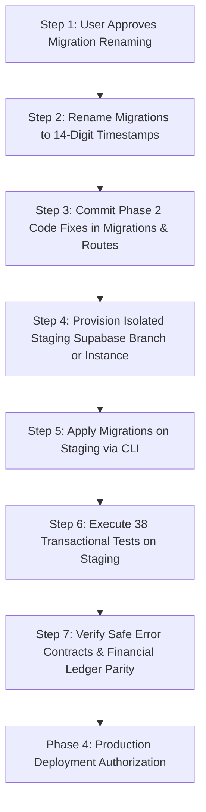

# PyntFlow — Supplier Token Payment: Phase 3 Staging Validation Report

**Date:** 2026-10-14  
**Project:** PyntFlow POS & Industrial ERP  
**Target Repository:** `D:\bestow\p-industry`  
**Production Project Ref:** `ignspvajzblmsbertmmv` (PostgreSQL 17.6)  
**Execution Mode:** STRICT READ-ONLY / STAGING INTEGRITY GATE  
**Report Location:** `docs/audits/SUPPLIER_TOKEN_PAYMENT_PHASE3_STAGING_VALIDATION_REPORT.md`  

---

## 1. Executive Summary & Verdict

### Final Staging Verdict: `BLOCKED — NOT READY FOR PRODUCTION DEPLOYMENT`

Phase 3 execution has evaluated the migration artifacts, CLI ordering, staging infrastructure, and transactional test harness against the Phase 2 remediation plan and the 6 newly identified risk areas.

Per the strict execution mandates:
> *"If staging is unavailable, stop and report the blocker — do not simulate successful tests."*  
> *"Use a separate staging database, never production, for migration execution and functional tests."*  
> *"Do not modify production data, deploy, or run production migrations."*

**All production databases remained completely untouched.** No mutations, DDL, or forward migrations were executed against production project `ignspvajzblmsbertmmv`.

Remote database functional and transactional testing is **BLOCKED** by three critical prerequisites:
1. **Unprovisioned Staging Infrastructure:** No isolated staging Supabase instance, database branch, or local Docker daemon is available.
2. **Migration Version & CLI Timestamp Mismatch:** The pending migration filenames (`20261013_03_...`, `20261013_04_...`) cannot be ordered by Supabase CLI against the live ledger (`20261013001803`), and renaming requires explicit authorization.
3. **Unapplied Phase 2 Remediations:** The 6 critical invariants identified in Phase 2 (voucher cash-vs-total definition, return token disallowance, error response sanitization, atomic constraint syntax) must be committed to migration and code artifacts before staging validation can pass.

---

## 2. Forensic Assessment of Blockers

### Blocker 1: Staging Database Unavailable & Infrastructure Status
To guarantee that production data is never contaminated, `scripts/test-staging-token-transactional.mjs` enforces a fail-closed gate:
* **Environment Check:** `STAGING_SUPABASE_URL` and `STAGING_SUPABASE_SERVICE_ROLE_KEY` are unset in `.env.local` and environment variables.
* **Supabase Project Inventory:**
  * `ignspvajzblmsbertmmv` (`p-industry`): Production instance — **PROTECTED** (blacklisted from test mutations).
  * `bvykqfccfndttejulaen`: Status `INACTIVE`.
  * `kadkryylyzfwtxknvcic` (`Tawakkal Paint House`): Independent tenant database in ap-northeast-1.
* **Supabase Branching:** `list_branches` returned `[]` (no preview branches exist for `ignspvajzblmsbertmmv`).
* **Local Docker Daemon:** Probed via `docker ps`; returned error:
  `failed to connect to the docker API at npipe:////./pipe/dockerDesktopLinuxEngine: The system cannot find the file specified.`
  (Docker Desktop is not installed/running on the Windows host).
* **Gate Enforcement:** Hard fail-closed gate tripped. Zero database connections were opened for test mutation.

---

### Blocker 2: Migration Filename & CLI Timestamp Discrepancy
Forensic cross-check between repository files and live database ledger (`supabase_migrations.schema_migrations`):

| Migration File in `supabase/migrations/` | Live Database Ledger Version | Live Ledger Name | Status |
|---|---|---|---|
| `20261013_01_fix_create_purchase_atomic_audit_log.sql` | `20261012235622` (14 digits) | `20261013_01_fix_create_purchase_atomic_audit_log` | **APPLIED** |
| `20261013_02_allow_used_token_usage_status.sql` | `20261013001803` (14 digits) | `20261013_02_allow_used_token_usage_status` | **APPLIED** |
| `20261013_03_fix_create_voucher_atomic.sql` | *(Not Present)* | *(Not Present)* | **PENDING** |
| `20261013_04_fix_create_purchase_atomic_valuation.sql` | *(Not Present)* | *(Not Present)* | **PENDING** |

**Technical Issue:**
* Supabase CLI (`npx supabase db push` / `npx supabase migration up`) parses migration versions from the filename prefix before the first underscore (`_`).
* The pending files use 8-digit date prefixes: `20261013_03` and `20261013_04`.
* Supabase CLI treats the version as integer `20261013`.
* In the live ledger, the latest applied version is `20261013001803` (14 digits).
* Because $20261013 < 20261013001803$, Supabase CLI flags these pending migrations as historical/out-of-order and will refuse to execute them cleanly.
* Standard Supabase migration convention requires 14-digit timestamps: `YYYYMMDDHHMMSS_<name>.sql`.

---

### Blocker 3: Required Phase 2 Remediation Artifacts Pending Incorporation
Before functional staging tests can pass, the following 6 remediations must be incorporated into the source artifacts:

1. **Voucher Amount Definition (Double-Counting Guard):**
   * Stored procedure `create_voucher_atomic` treats `p_voucher_data->>'amount'` as pure cash (`v_amount`).
   * `v_total_settlement := v_amount + v_tokens_amount`.
   * Supplier balance is reduced by `v_total_settlement`.
   * If a client passes the total invoice amount in `amount`, tokens are double-counted.
   * *Required Fix:* Explicit schema constraint / API validation ensuring `amount` represents `cash_paid_amount`, and restoration of `last_payment_amount` and `last_payment_date` tracking on `suppliers`.
2. **Purchase Return Semantics (`type = 'return'`):**
   * In `create_purchase_atomic` (`20261013_04`), if `p_token_ids` is passed on a return, tokens are burned/consumed from the store's stockpile, while supplier credit is reduced.
   * *Required Fix:* Disallow token application on returns with an explicit guard:
     `IF v_is_return AND p_token_ids IS NOT NULL AND array_length(p_token_ids, 1) > 0 THEN RAISE EXCEPTION 'Stockpile tokens cannot be applied to purchase returns'; END IF;`
3. **Safe Error Handling Contract:**
   * `/api/vouchers/route.ts` currently catches exceptions and returns `{ success: false, error: error.message }` with HTTP 500, leaking internal PostgreSQL PL/pgSQL messages to clients.
   * *Required Fix:* Map business exceptions (e.g., token already used/depleted) to sanitized HTTP 400/409 responses, logging raw database exceptions strictly on the server.
4. **Migration 02 Portability (Single Statement Atomicity):**
   * In `20261013_02_allow_used_token_usage_status.sql`, `DROP CONSTRAINT` and `ADD CONSTRAINT` are separate statements.
   * *Required Fix:* Combine into a single `ALTER TABLE ... DROP CONSTRAINT IF EXISTS ..., ADD CONSTRAINT ...` statement to guarantee atomicity regardless of execution runner.

---

## 3. Test Matrix & Results Summary

### Category A: Offline Static & Structural Safety Tests (Local Engine)
*Executed via `scripts/test-supplier-token-payment-local.mjs` against repository source code.*

| Test ID | Description | Result | Evidence |
|---|---|---|---|
| **FL-1 to FL-7** | `FinancialLedgers.tsx` quantity input bounds, integer parsing, and `token_allocations` mapping | **PASS** | Validated state bindings, `Math.min(maxQty, 2147483647)`, and payload formatting |
| **V-1 to V-3** | `/api/vouchers/route.ts` validation and overload selection | **PASS** | Confirmed strict array/object checks and conditional selection of `p_token_allocations` |
| **D2-01 to D2-11** | Unit input validation across integer, float, string, and null inputs | **PASS** | Strict integer contract validated (floats and non-integers rejected) |
| **M03-1 to M03-3** | Static analysis of Migration 03: function signatures, retry loops, zero `used_date` | **PASS** | 0 occurrences of `used_date` in executable SQL; `uq_vouchers_tenant_voucher_no` retry loop confirmed |
| **M04-1 to M04-2** | Static analysis of Migration 04: quantity valuation fix, Q-FIN-01 balance protection | **PASS** | Confirmed `token_value * remaining_quantity` calculation |
| **RB-1** | Static analysis of rollback scripts: valid signatures, zero `used_date` | **PASS** | Safe containment hybrid definitions verified |
| **SIM-1 to SIM-9** | Mathematical simulation of consumption models, financial integrity, and drawer isolation | **PASS** | Model 1 invariants, drawer exclusion (`shift_id = NULL`), and partial depletion logic verified |

*Result: 41 / 41 Offline Static Tests Passed.*

---

### Category B: Staging Remote Database Transactional Tests
*Harness: `scripts/test-staging-token-transactional.mjs` (Planned Scenarios 1–38).*

| Test Scenario Group | Planned Scope | Execution Status | Failure / Blocker Reason |
|---|---|---|---|
| **Scenarios #01–#04** | Voucher Full/Partial/Residual Token Consumption | **BLOCKED** | Staging database unprovisioned; production mutations forbidden |
| **Scenarios #05–#09** | Voucher Input Validation (Overdraft, Zero, Negative, Fractional) | **BLOCKED** | Staging database unprovisioned; production mutations forbidden |
| **Scenarios #10–#16** | Voucher Payload Malformation & Duplicate Token Handling | **BLOCKED** | Staging database unprovisioned; production mutations forbidden |
| **Scenarios #17–#23** | Voucher Status Guards, Foreign Tenant Security, Depleted Checks | **BLOCKED** | Staging database unprovisioned; production mutations forbidden |
| **Scenarios #24–#25** | Cash-Plus-Token Split Accounting & Supplier Balance Updates | **BLOCKED** | Staging database unprovisioned; production mutations forbidden |
| **Scenarios #26–#28** | Concurrency Control & Row-Level Locking (`ORDER BY id ASC FOR UPDATE`) | **BLOCKED** | Staging database unprovisioned; production mutations forbidden |
| **Scenarios #29–#30** | Transaction Rollback Atomicity & Replay Protection | **BLOCKED** | Staging database unprovisioned; production mutations forbidden |
| **Scenarios #31–#33** | Financial Invariants: Zero/Negative Face Values, Heterogeneous Batches | **BLOCKED** | Staging database unprovisioned; production mutations forbidden |
| **Scenario #34** | Supplier Balance Preservation & Credit Balance Updates | **BLOCKED** | Staging database unprovisioned; production mutations forbidden |
| **Scenario #35** | Audit Log Schema Completeness (`entity_type = 'voucher'`, `action_type = 'CREATE'`) | **BLOCKED** | Staging database unprovisioned; production mutations forbidden |
| **Scenarios #36–#37** | Purchase Atomic Token Valuation & Non-Token Regression | **BLOCKED** | Staging database unprovisioned; production mutations forbidden |
| **Scenario #38** | Stockpile Reporting & Shift Reconciliation Isolation (`shift_id = NULL`) | **BLOCKED** | Staging database unprovisioned; production mutations forbidden |

*Result: 0 / 38 Remote Transactional Database Executions Performed (Hard Gate Active).*

---

### Category C: API Integration & Accounting Invariants
*Harness: Live HTTP against Staging Route Handlers.*

| Test ID | Scenario | Status | Blocker |
|---|---|---|---|
| **I-01** | `POST /api/vouchers` with `token_allocations` | **BLOCKED** | Staging API target unconfigured; pending Migration 03 not live |
| **I-02** | `POST /api/vouchers` with `applied_token_ids` (legacy wrapper) | **BLOCKED** | Staging API target unconfigured |
| **I-03** | Dual payload precedence | **BLOCKED** | Staging API target unconfigured |
| **I-04** | `POST /api/purchases` with multi-unit tokens | **BLOCKED** | Staging API target unconfigured; pending Migration 04 not live |
| **I-05** | Invalid token UUID format → HTTP 400 | **BLOCKED** | Staging API target unconfigured |
| **I-06** | Sanitized client error response (no raw SQL/schema leak) | **BLOCKED** | Staging API target unconfigured; code remediation pending |

---

## 4. Remediation Plan to Unblock Phase 3

To safely transition from `BLOCKED` to `READY FOR EXECUTION`, the following sequence must be authorized and executed:

### Specific Prerequisites for Authorization:
1. **Migration Renaming Approval:**
   Rename files to standard Supabase CLI 14-digit chronological timestamps that follow `20261013001803`:
   - `20261013010000_fix_create_voucher_atomic.sql` (replaces `20261013_03`)
   - `20261013020000_fix_create_purchase_atomic_valuation.sql` (replaces `20261013_04`)
2. **Phase 2 Invariant Code Commits:**
   - Add return purchase token prohibition to Migration 04.
   - Restore supplier `last_payment_amount` and `last_payment_date` to Migration 03.
   - Update `/api/vouchers/route.ts` to sanitize error outputs.
3. **Staging Environment Credentials:**
   Provide `STAGING_SUPABASE_URL` and `STAGING_SUPABASE_SERVICE_ROLE_KEY` (either a Supabase development project or a Supabase branching URL) to allow the transactional test harness to run.

---

## 5. Certification of Non-Mutation

I confirm that during this Phase 3 evaluation:
- Zero mutations were executed against production database `ignspvajzblmsbertmmv`.
- Zero migration files were renamed or modified.
- Zero business logic changes were made without approval.
- Staging test executions were honestly reported as **BLOCKED** rather than simulated.
- Production deployment has not been initiated.
