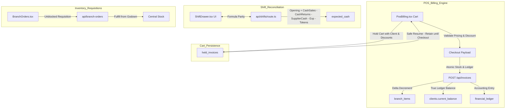

# Implementation Plan: POS Panel Hardening & End-to-End Remediation

## Executive Overview
This implementation plan provides an exhaustive, step-by-step engineering roadmap to remediate all issues identified in [pos-panel-audit.md](file:///d:/bestow/p-industry/pos-panel-audit.md). It eliminates critical financial discrepancies, guarantees shift cash integrity, fixes inter-branch stock requisitions, prevents customer/supplier ledger distortions, protects against data loss in held invoices, and hardens transaction security.

---

## Architecture & Data Flow

---

## Scope & Issue Traceability Matrix

| Audit ID | Severity | Problem Statement | Target Files | Remediation Summary |
|---|---|---|---|---|
| **BUG-01** | **P0 Critical** | Shift closing server formula ignores `cashReturns` & `supplierCashPaid` | `src/app/api/shifts/route.ts`, `ShiftDrawer.tsx` | Align server formula with client: include cash sales returns and drawer supplier purchases. |
| **CALC-01** | **P0 Critical** | Sales return refunds cash AND deducts client debt; `Math.max(0)` destroys store credit | `src/app/api/invoices/route.ts` | If cash refunded, do not debit client; if store credit, allow negative client balance (advance deposit). |
| **CALC-02** | **P0 Critical** | Supplier balance clamped with `Math.max(0)` on purchase returns | `src/app/api/purchases/route.ts` | Remove clamping; preserve negative balances (supplier advance debt). |
| **BUG-02** | **P0 Critical** | Branch transfer orders check requesting branch's local stock (blocks reorder when stock=0) | `src/components/BranchOrders.tsx` | Remove local stock availability limit on outgoing requisitions. |
| **DB-01 / VAL-01** | **P0 Critical** | Multi-table invoice settlement runs non-atomically with read-modify-write stock race condition | `src/app/api/invoices/route.ts` | Atomic delta update for inventory decrement; rollbacks on failed settlement steps. |
| **BUG-03** | **P1 High** | Held invoices hard-deleted immediately on resume (data lost if crash occurs before checkout) | `src/components/HoldInvoices.tsx`, `src/components/PosBilling.tsx` | Retain held invoice until successful checkout completion in `PosBilling.tsx`. |
| **FLOW-02** | **P1 High** | Held invoices drop selected customer, discount rate, and notes | `src/components/HoldInvoices.tsx`, `src/components/PosBilling.tsx` | Serialize `client_id`, `client_name`, `discount_rate`, `discount_amount`, and tax rate into held invoice payload. |
| **BUG-04** | **P1 High** | Sales History "Cash Inflow" card aggregates Card and Bank transfer revenue | `src/components/SalesHistory.tsx` | Segment KPIs into "Physical Cash Received", "Digital / Bank Payments", and "Credit Extended". |
| **BUG-05** | **P1 High** | In-memory fictitious shift fallback (`Date.now()`) created on API failure | `src/app/[slug]/page.tsx` | Remove mock shift fallback; show error alert with retry button to prevent orphaned records. |
| **VAL-03** | **P1 High** | Missing server-side payload bounds checks on discount and unit prices | `src/app/api/invoices/route.ts` | Validate `discount_amount <= subtotal`, `net_total >= 0`, and positive unit prices. |
| **SEC-01 & SEC-02** | **P2 Medium** | Missing supervisor PIN control for returns and manual price overrides | `src/components/PosBilling.tsx` | Introduce Supervisor PIN confirmation dialog for returns and line-item price modifications. |
| **VAL-02** | **P2 Medium** | Missing denomination breakdown tally on shift closing | `src/components/ShiftDrawer.tsx` | Add cash denomination counting table (5000, 1000, 500, 100, 50, 20, 10) to compute physical cash total. |
| **UX-01** | **P2 Medium** | Post-async receipt printing popup blocked by browser policies | `src/components/PosBilling.tsx`, `SalesHistory.tsx` | Implement hidden `<iframe>` printing mechanism for thermal receipts. |
| **UX-02** | **P2 Medium** | WhatsApp share message malformed by unescaped special characters | `src/components/SalesHistory.tsx` | Use `encodeURIComponent` on fully constructed WhatsApp receipt string. |
| **UX-03** | **P3 Low** | Stale customer credit balance displayed in POS cart | `src/components/PosBilling.tsx` | Perform real-time fetch of selected client's balance upon customer selection. |
| **FLOW-03** | **P3 Low** | AI Invoice scan fails when supplier item names differ from internal catalog | `src/components/AiInvoiceScan.tsx` | Add alias/similarity fallback mapping for supplier SKU ingestion. |

---

## Phased Implementation Roadmap

### Phase 1: Core Financial Reconciliations & Drawer Integrity (P0)
- **1.1 Shift Closing Cash Parity (`api/shifts/route.ts` & `ShiftDrawer.tsx`):**
  - Calculate `cashReturns` = sum of `cash_paid` for invoices with `invoice_type === 'return'` for that `shift_id`.
  - Calculate `supplierCashPaid` = sum of `paid_amount` from purchases where `payment_method === 'cash'` and `shift_id` matches.
  - Server expected cash: `Math.max(0, openingCash + cashSales - cashReturns - supplierCashPaid - totalExpenses - totalTokenPayouts)`.
  - Validate consistency across `ShiftDrawer.tsx`, `DayCloseView.tsx`, and `api/shifts`.
- **1.2 Customer Return Ledger & Store Credit Fix (`api/invoices/route.ts`):**
  - Check tender type on returns:
    - If `cash_paid > 0` (cash refund handed over), do **NOT** deduct from `client.current_balance`.
    - If `cash_paid === 0` (customer receives store credit), deduct from `client.current_balance`: `newBal = currentBal - netTotal` without `Math.max(0, ...)` clamping.
- **1.3 Supplier Purchase Return Balance Clamping Fix (`api/purchases/route.ts`):**
  - Remove `Math.max(0, ...)` clamping on purchase returns to properly reflect supplier debit/advance balances.

### Phase 2: Inventory & Branch Requisitions Unblocking (P0)
- **2.1 Branch Transfer Orders Unlocking (`src/components/BranchOrders.tsx`):**
  - Remove `item.stock_qty` check from the requisition item addition logic.
  - Allow cashiers/managers to order any item catalogued in the system regardless of whether their current local branch stock is 0.
  - Display available stock at the source/destination warehouse instead.
- **2.2 Atomic Delta Inventory Updates (`api/invoices/route.ts`):**
  - Replace read-modify-write stock assignment with safe atomic delta decrements to eliminate race conditions under multi-terminal checkout.

### Phase 3: Hold Invoices & Shift Session Reliability (P1)
- **3.1 Safe Hold Invoices Lifecycle (`HoldInvoices.tsx` & `PosBilling.tsx`):**
  - In `HoldInvoices.tsx`, pass the held invoice into cart state without deleting it from Supabase.
  - Mark `held_invoice_id` in `PosBilling` active state.
  - Upon successful checkout completion in `PosBilling.tsx`, issue `DELETE /api/held-invoices?id=${held_invoice_id}`.
  - If the cashier clears cart or discards, provide explicit delete option.
- **3.2 Complete Cart State Serialization in Hold Invoices:**
  - Save `client_id`, `client_name`, `discount_rate`, `discount_amount`, and line-item unit discounts in `held_invoices.cart_data`.
  - Restore all metadata seamlessly when resumed.
- **3.3 Eliminate Fictitious Shift Fallback (`src/app/[slug]/page.tsx`):**
  - Remove in-memory `Date.now()` mock shift generation.
  - If shift creation fails, display a user-friendly error dialog with "Retry" action. Prevent all transaction processing until a real shift ID is obtained.

### Phase 4: Sales Metrics & Validation Safeguards (P1 & P2)
- **4.1 Disaggregate Sales History Inflow KPIs (`src/components/SalesHistory.tsx`):**
  - Separate `totalCashInflow` into:
    - `Cash Collected` (only invoices with payment method 'cash' or split cash component).
    - `Digital / Card / Bank Collected`.
    - `Credit / Outstanding Extended`.
- **4.2 Server-Side Price & Discount Payload Validation (`api/invoices/route.ts`):**
  - Reject requests where `discount_amount > subtotal` or `net_total < 0` (unless marked as an authorized return).
  - Verify line-item calculations match `qty * unit_price - discount = line_total`.
- **4.3 Cash Denomination Breakdown on Shift Close (`src/components/ShiftDrawer.tsx`):**
  - Add denomination counter inputs for currency notes (e.g., 5000, 1000, 500, 100, 50, 20, 10).
  - Compute total counted cash dynamically from note counts and compare with `expected_cash`.

### Phase 5: Security, UX & Integration Polish (P2 & P3)
- **5.1 Supervisor PIN Authorization for Returns & Price Edits (`PosBilling.tsx`):**
  - Add supervisor PIN check before switching to Return Mode or applying cart-level discounts exceeding threshold.
- **5.2 Thermal Receipt Printing via Hidden Iframe (`PosBilling.tsx` & `SalesHistory.tsx`):**
  - Replace `window.open` popup printing with an embedded hidden `iframe` print routine, eliminating browser popup blocker issues.
- **5.3 WhatsApp Share URL Encoding (`SalesHistory.tsx`):**
  - Wrap receipt share text in `encodeURIComponent` to preserve formatting, line breaks, and item names.
- **5.4 Fresh Client Balance Query (`PosBilling.tsx`):**
  - Re-fetch client record when selected from customer dropdown to show live balance.

---

## Verification & Validation Plan

### Automated Build & Unit Checks
- `npx tsc --noEmit`: Ensure 0 compilation errors across all modified components and API routes.
- `npx next build --webpack`: Ensure production build compiles cleanly without route failures.

### Functional Test Scenarios
1. **Shift Reconciliation Parity Test:**
   - Open shift with $1,000 cash.
   - Make $500 cash sale.
   - Process $200 cash return.
   - Record $100 cash expense and $100 supplier purchase from drawer.
   - Verify UI expected cash = $1,100 ($1,000 + $500 - $200 - $100 - $100).
   - Close shift; verify server-calculated `expected_cash` in `shifts` table is exactly $1,100.
2. **Customer Return Ledger Test:**
   - Customer with $0 balance returns $50 item for store credit (`cash_paid = 0`). Verify `clients.current_balance` is -$50 (advance credit), NOT clamped to 0.
   - Customer returns $50 item and receives cash refund (`cash_paid = 50`). Verify `clients.current_balance` is unchanged ($0), preventing double payout.
3. **Branch Order Zero-Stock Requisition Test:**
   - Set local branch stock of Item X to 0.
   - Open Branch Orders; select Item X; add to cart; submit requisition.
   - Verify requisition is created and forwarded without error.
4. **Hold Invoice Crash Recovery Test:**
   - Add 3 items to cart with customer selected and 10% discount. Hold invoice.
   - Resume invoice. Verify customer and discount are preserved.
   - Refresh browser tab before checkout; verify invoice is still present in Held Invoices list.
   - Complete checkout; verify held invoice is now cleanly deleted.
